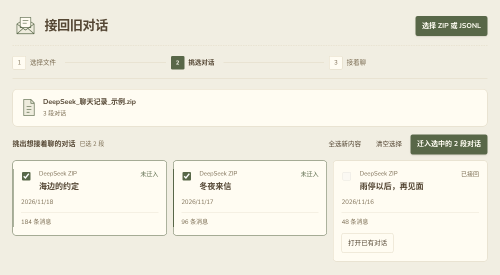
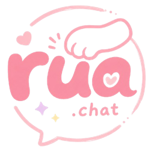
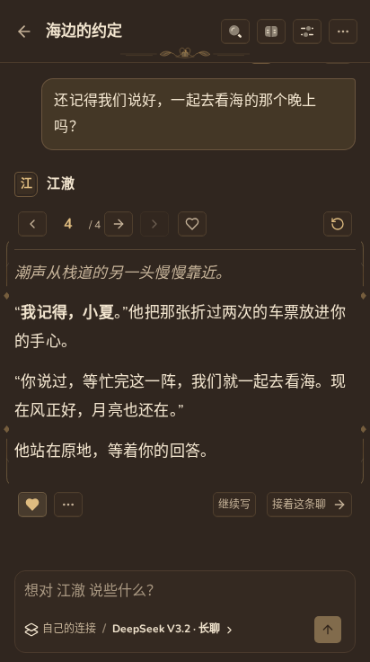
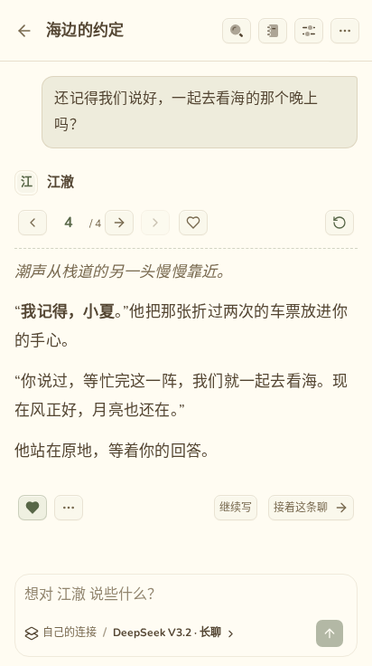
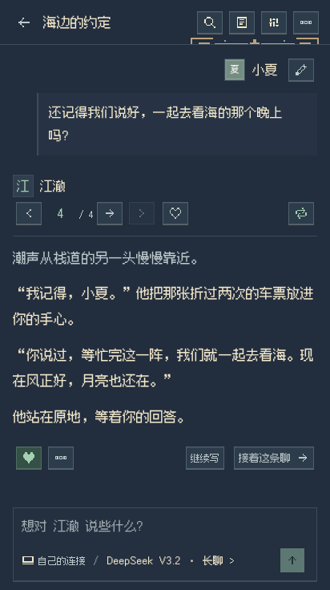
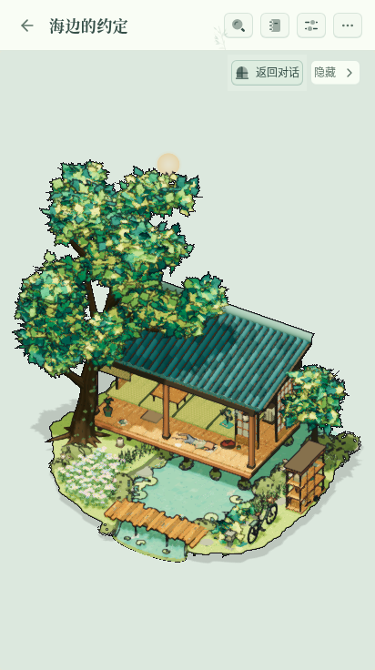

#  Tavern Kit

[](https://github.com/deepseek-ai/deepseek-harness)

Tavern Kit 是一套给 DeepSeek Harness 用的角色聊天插件，支持导入旧会话、使用酒馆角色卡，以及选择自己的模型服务。**公益、非盈利，插件免费使用。**

## DeepSeek 网页端的会话，可以导入继续聊

**遇到 DeepSeek 网页端限流、额度限制，或会话长度不够用时，可以把已有会话导入 Tavern Kit。** 从网页端导出会话 ZIP，在「接回旧对话」中预览并选择要迁入的会话，再连接模型继续聊。



## 社区共创伙伴

感谢为项目提供主题、使用反馈和社区支持的伙伴，欢迎更多平台参与。

| 伙伴 | 介绍 |
| :---: | :--- |
| <a href="https://api.rua.chat"></a> | **[rua.chat](https://api.rua.chat)** · 提供模型 API 服务，采用好事岛界面，站内有多种优惠活动。<br>好事岛主题也由 rua.chat 站长提供给 Tavern Kit。可前往站点查看模型与当前活动。 |

**想参与共创？** 欢迎[提交 Issue](https://github.com/Tavern-Kit/dsh-tavern-kit/issues/new)，附上平台图标、链接、简介，以及想参与的内容，审核后会加入这里和插件内的社区共创伙伴页面。

##  四套主题

| 经典酒馆 | 好事岛 |
| :---: | :---: |
|  |  |
| **像素旅店** | **溪间四时** |
|  |  |

在「换个装扮」里选择主题，调整字号、阅读宽度、背景和气泡。配色可以跟随系统，也可以固定浅色或深色；溪间四时还支持切换春、夏、秋、冬。

**主题包支持自定义。** 导出主题 ZIP，修改配色、字体、插画或布局，再导入使用。**好事岛主题由 [rua.chat 站长](https://api.rua.chat) 提供。**

## 开始聊

### 第一步：安装插件

在 DSH 的插件管理里安装并启用 `@tavern-kit/suite`，侧栏会出现「继续聊天」。当前适配版本为 **DSH 0.2.2-rc.3**。[获取 DeepSeek Harness](https://github.com/deepseek-ai/deepseek-harness)

使用本地安装包时，请将组合包和五个依赖包一同交给安装器。

### 第二步：导入会话，或带上角色卡

| 你想做什么 | 在哪里操作 |
| :--- | :--- |
| **接着聊 DeepSeek 网页端的会话** | 在「接回旧对话」中选择网页端导出的 ZIP，预览后选中需要的会话，再迁入。 |
| **迁入 SillyTavern 会话** | 在「接回旧对话」中选择一对一聊天 JSONL，确认人物与消息后迁入。 |
| **从角色卡开始** | 选择「带上角色卡」，导入角色卡、世界书和预设，选开场白，填写称呼与人设。常用人设可以保存，下次直接选。 |
| **恢复 Tavern Kit 备份** | 在首页选择「恢复对话」，导入此前导出的完整会话备份。 |

### 第三步： 连接模型，发送第一句

DSH 中已经配置好的连接可以直接使用，也可以在「模型连接」里添加自己的服务。

| 接入方式 | 怎么用 |
| :--- | :--- |
| **已有聊天 key** | 选择「粘贴聊天 key」，填写 API 地址和 key，拉取可选模型后保存连接。 |
| **[new-api](https://docs.newapi.pro/zh/docs) 站点账号** | 在「站点账号」中保存账号站点与模型 API 地址，用账号密码登录，或选择 **[PAT（个人访问令牌）](https://docs.newapi.pro/zh/docs/guide/feature-guide/user/security#创建和管理访问令牌)** 接入。 |

连接 new-api 账号后，可以在同一页查看分组、模型和账户额度。从自己的已有密钥中选一把，点击「用于聊天」，当前 key 的额度会单独显示。回到聊天页，选好连接和模型，就能继续对话。

<details>
<summary>PAT 在哪里创建？</summary>

到站点的「安全与访问 → 访问令牌」创建，勾选「个人资料：查看」「API 密钥：查看、查看完整密钥」「钱包：查看」。在插件中选择「个人访问令牌」，粘贴到「账号访问令牌」输入框。

PAT 用于读取账号信息，聊天使用随后由你选中的 API 密钥。详细步骤见 [new-api 官方 PAT 指南](https://docs.newapi.pro/zh/docs/guide/feature-guide/user/security#创建和管理访问令牌)。

</details>

### 聊天中常用的操作

| 想做什么 | 操作 |
| :--- | :--- |
| 换一条回复，或修改当前回复 | 点击「换个回复」再试一次，标记喜欢的候选；也可以直接编辑回复，原文和已有后续会保留。 |
| 接着某段旧剧情聊 | 搜索正文，打开对应消息，再点「从这里继续」。 |
| 查看或修改 MVU 变量 | 使用 MVU 的角色可在「剧情变量」中查看和修改当前回复的变量。 |
| 备份整段对话 | 点击「把这段对话带走」，将分支、候选、备忘和用到的素材一起导出。换一份 DSH 后，可从首页恢复，再选择模型连接。 |

## 本地保存与隐私

角色卡、世界书、预设和聊天记录保存在你自己的 DSH 数据目录，连接凭据由 DSH 的凭据管理保存。**酒馆卡在本地导入和保存，全程不联网。**

登录、查询额度和发送聊天时，直接连接你选择的站点或模型服务；Tavern Kit 不会把这些数据另行上传到其他第三方服务器。代码完全开源，可以在[插件源码](packages/)中查看保存与请求的实现。

## 从源码构建

需要 Node.js 24、pnpm 11 和 DSH 0.2.2-rc.3。请在仓库根目录执行以下命令。

```sh
pnpm install --frozen-lockfile
pnpm check
```

`pnpm check` 会构建插件、运行测试，并把验证过的本地安装包放到 `.build/packs/`。测试默认从 npm 全局目录找 DSH。如果 DSH 装在别处，将 `DSH_TEST_INSTALL_ANCHOR` 设为该安装的 `package.json` 路径。

[主题文件格式](packages/rp-appearance/README.md#主题文件) · [内置主题](packages/rp-appearance/themes/)

## 许可

项目采用 AGPL-3.0-only。上游代码、字体、图标与主题素材的来源和许可随包附带。[许可证](LICENSE) · [开源来源](ATTRIBUTIONS.md)
